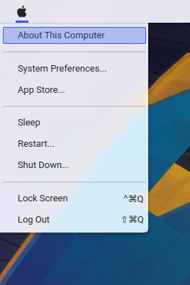
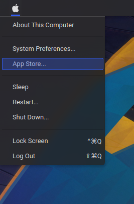

# Kpple Menu
The Kpple menu is a drop-down menu that is usually found on the left side of the menu bar.
The original maintainer does not seem actively maintaining the project anymore. In order to port the plasmoid to KF6 I created this fork.

## Previews

<p align="center">
     
</p>

## Usage

Menu entries can be configured via the settings, if you tick the advanced settings checkbox.
Simply click on the entries to check if the configured command is working.
The commands should work on all Distributions with KDE Plasma 6, but might have to be adjusted manually.
For example, some distributions like Fedora Kinoite provide Qt6 `qdbus` as `qdbus-qt6` instead of `qdbus6`.
If menu actions do not work out of the box, open advanced settings and change `qdbus6` to `qdbus-qt6` in the affected commands.

### Keyboard Navigation

A global shortcut to expand the applet can be configured under settings -> Keyboard Shortcuts.
You can navigate through the menu with either tab and back-tab or arrow keys.
Selected Entries can be executed by pressing the return, enter or space key.
While the menu is open and focused, you can:

- Lock the screen with **Ctrl+Alt+Q** or **Ctrl+Meta+Q**.
- Log out with **Shift+Alt+Q** or **Shift+Meta+Q**.

Meta is usually the Windows/Super key on a PC keyboard or Command on an Apple
keyboard, depending on the keyboard mapping. These actions are local to the
open menu; they do not register global shortcuts.

Under **General → Shortcut labels**, choose **Apple symbols** (the default) or
**PC labels**. This changes the displayed hints; both shortcut variants work
with either style.

## Translations

Translations for all current interface strings are provided in 17 languages.
To improve a translation or add a language, edit the corresponding `.po` file
under `package/translate` and open a pull request. See the translation guide in
`package/translate/ReadMe.md` for details.

## Installation

The recommended installation method is via the [KDE store](https://store.kde.org/p/2164679).


### Install from Git with CMake

Install Git, Bash, Python 3, gettext (`msgfmt`), CMake, a C/C++ toolchain,
and the development packages for Extra CMake Modules, Qt 6, KDE Frameworks 6,
Kirigami Addons, and Plasma 6. Package names depend on your distribution.

Clone the repository, build the translations, and install for your user:

```bash
git clone https://github.com/chrtall/kppleMenu.git
cd kppleMenu
./create-translations.sh
cmake -S . -B build -DCMAKE_INSTALL_PREFIX="$HOME/.local"
cmake --build build
cmake --install build
```

This installs the widget into
`~/.local/share/plasma/plasmoids/com.github.chrtall.kppleMenu/` without `sudo`.
If you already have a checkout, run the commands starting with
`./create-translations.sh` to install that checkout's version or update an
existing installation.

Log out and back in after updating so Plasma loads the new QML. For a first
installation, add **Kpple Menu** through Plasma's **Add Widgets** panel.

Run `./create-translations.sh` again after changing translations and before
installing. CMake copies the compiled catalogs but does not regenerate them.
The generated `.mo` files, `package/contents/locale/`, and `build/` are ignored
by Git; the `.po` files remain the translation sources.

### Install with KPackageTool

For this QML widget, you can also install without CMake or development packages.
You need Bash, Python 3, gettext (`msgfmt`), and `kpackagetool6` on a Plasma 6
desktop. From the repository root:

```bash
./create-translations.sh
kpackagetool6 --type "Plasma/Applet" --install package
```

To update an existing installation, use `--upgrade package` instead of
`--install package`. Log out and back in after updating.

## Local preview

Run `./test-plasmoid.sh` to preview the widget in your current desktop language.
Pass a language code to preview a translation:

```bash
./test-plasmoid.sh de     # German
./test-plasmoid.sh fr     # French
./test-plasmoid.sh zh_TW  # Traditional Chinese
./test-plasmoid.sh en     # English
```

The script calls `create-translations.sh` to rebuild the translation catalogs
before launching `plasmoidviewer`.
It adds the package's local translations to the viewer's search path, so the
widget itself can use them without being installed.
It requires `msgfmt` (gettext), Python 3, and `plasmoidviewer` (Plasma SDK).
Run `./test-plasmoid.sh --help` to list the available language codes.
Untranslated strings fall back to English when a language is selected explicitly.
The script prefers an installed UTF-8 locale for the selected language, and falls
back to another installed UTF-8 locale if needed. At least one locale other than
`C.UTF-8` must be installed for translation previews.

## License

GNU GPL v2.0
